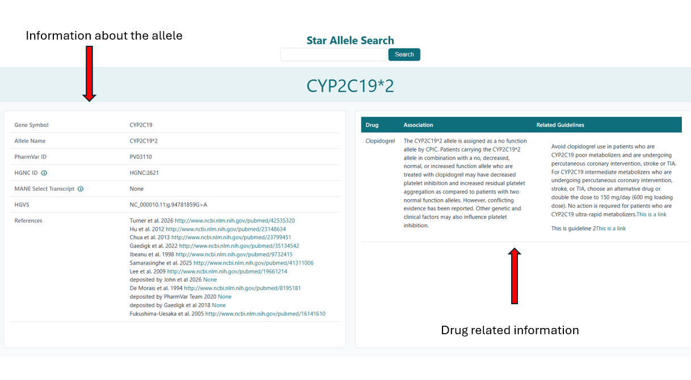

# Star-Allele-Search


<small><em>Figure 1. Star-Allele-Search homepage.</em></small>

Welcome to the Star-Allele-Search documentation.

Star-Allele-Search is a pharmacogenomics application designed to retrieve, validate and annotate pharmacogenomic star alleles using information from PharmVar, ClinPGx and CPIC resources. The software provides researchers, clinical scientists and healthcare professionals with a simple interface for exploring pharmacogenomic alleles, associated phenotypes and clinical guidance. 

---

## What is a Star Allele?

Many pharmacogenomic genes are described using **star allele nomenclature** rather than individual sequence variants.

Examples include:

```text
CYP2C19*2
CYP2D6*4
TPMT*3A
SLCO1B1*5
```

A star allele represents a group of genetic variants that are inherited together as a haplotype and have a known impact on drug response. Star alleles are widely used in pharmacogenomics because they provide a concise and clinically meaningful way to describe pharmacogenetic variation. 

For example, CYP2C19*2 is associated with reduced enzyme activity and can influence response to medications such as clopidogrel. 

---

## Getting Started

Choose the section that best matches your needs.

### Installation

Set up Star-Allele-Search using either:

- [Local Installation](local_installation.md)
- [Docker Installation](docker_installation.md)

### Search and Annotation

Learn how to search for pharmacogenomic star alleles and interpret the returned annotations.

See the [User Guide](user-guide/index.md)

### Technical Documentation

Explore the software architecture, internal modules and implementation details.

See the [Technical Manual](technical-manual/index.md)

### Testing and Quality Assurance

Review automated testing, code coverage and continuous integration workflows.

See [Testing](testing.md)

---

## How Star-Allele-Search Works

```text
Star Allele Query
        │
        ▼
 PharmVar Retrieval
        │
        ▼
 Gene Validation (HGNC + Variant Validator)
        │
        ▼
 ClinPGx Annotation Retrieval
        │
        ▼
 Guideline Retrieval
        │
        ▼
 Structured Results
```

The software combines information from multiple pharmacogenomic resources to provide a consolidated view of allele definitions, functionality, phenotypes and clinical recommendations.

---

## Example Search

The image below shows an example Star-Allele-Search query.


*Figure 1. Example star allele search interface.*

The application retrieves information from external pharmacogenomic resources and returns a structured summary.



*Figure 2. Example annotated search results returned by Star-Allele-Search.*

---

## Supported Resources

### PharmVar

The Pharmacogene Variation Consortium (PharmVar) is a centralised repository of pharmacogene variation data and star allele nomenclature. PharmVar provides definitions for core alleles, sub-alleles, functional annotations and stable PharmVar identifiers (PVIDs).

### ClinPGx

ClinPGx is a comprehensive resource supporting the clinical implementation of pharmacogenomics and provides information on genes, alleles, phenotypes and guideline annotations. 

### CPIC

The Clinical Pharmacogenetics Implementation Consortium (CPIC) publishes evidence-based pharmacogenomic prescribing guidelines that help healthcare professionals understand how genetic variation may affect drug response. 

---

## Common Use Cases

### Clinical Interpretation

Retrieve pharmacogenomic information for clinically relevant genes and alleles to support interpretation of genetic test results.

### Research

Explore allele definitions and clinical annotations for pharmacogenomics research and method development.

### Validation

Verify allele nomenclature and compare information across multiple pharmacogenomic resources.

### Education

Learn about star allele nomenclature, diplotypes and pharmacogenomic phenotypes.

---

## New to Pharmacogenomics?

If you are unfamiliar with pharmacogenomic terminology, the following concepts may be useful:

- Star alleles
- Core alleles
- Sub-alleles
- Diplotypes
- Phenotypes
- Pharmacogenomic prescribing guidelines

The User Guide contains additional examples and background information to help new users understand these concepts. 

---

## Acknowledgements

Star-Allele-Search was developed as part of the STP Introduction to Software Engineering project to support the retrieval and interpretation of pharmacogenomic star allele informations.

---

## References

- [PharmVar: Pharmacogene Variation Consortium](https://www.pharmvar.org/)
- [ClinPGx: Clinical Pharmacogenomics Resource](https://www.clinpgx.org/)
- [CPIC: Clinical Pharmacogenetics Implementation Consortium](https://cpicpgx.org/)
