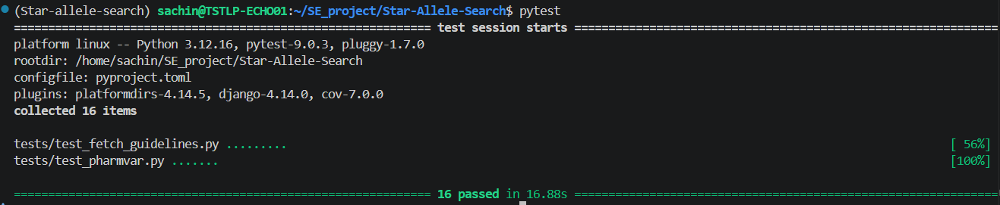
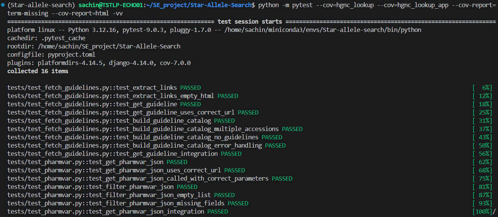

# Technical Manual

## Introduction

Star-Allele-Search is a pharmacogenomics application developed to retrieve, validate and annotate pharmacogenomic star allele information.

The application integrates information from multiple external resources, including PharmVar, ClinPGx, HGNC and VariantValidator, to provide allele-specific information, phenotype annotations and clinical guideline recommendations.

---

## System Architecture

The software follows a modular architecture.

```text
User Input
     │
     ▼
 Star Allele Search
     │
 ┌───┼────────────────────┐
 │   │                    │
 ▼   ▼                    ▼
HGNC Validation   PharmVar Retrieval
 │                     │
 └────────┬────────────┘
          ▼
 ClinPGx Annotation Retrieval
          │
          ▼
 Guideline Processing
          │
          ▼
 Structured Results
```

The application integrates with the following external resources:

- PharmVar
- ClinPGx
- HGNC
- VariantValidator
- TerraCipher

---

## Project Structure

```text
Star-Allele-Search
│
├── App/
│   ├── pharmvar_json.py
│   ├── vv_validation.py
│   ├── hgnc_id.py
│   ├── clinpgx_summary_annotation.py
│   └── fetch_guidelines.py
│
├── tests/
│
├── sas-docs/
│
├── environment.yaml
├── requirements.txt
├── pyproject.toml
└── README.md
```

### App

Contains the application source code and integration modules.

### tests

Contains automated unit and integration tests.

### sas-docs

Contains MkDocs documentation used to generate the project website.

### pyproject.toml

Defines package metadata, build configuration and dependency management.

### environment.yaml

Defines the Conda environment used during development.

---

## Core Modules

### pharmvar_json.py

Responsible for retrieving star allele information from the PharmVar API.

#### Key Functions

- `get_pharmvar_json()`
- `filter_pharmvar_json()`

#### Responsibilities

- Connect to the PharmVar API
- Retrieve allele definitions
- Process JSON responses
- Generate simplified outputs

---

### vv_validation.py

Responsible for variant validation using the VariantValidator REST API.

#### Key Functions

- `validate_pharmvar_result()`

#### Responsibilities

- Validate PharmVar variants
- Retrieve MANE Select transcript representations
- Verify variant nomenclature

---

### hgnc_id.py

Responsible for HGNC gene symbol validation and HGNC identifier retrieval.

#### Key Functions

- `get_hgnc_json()`
- `get_hgnc_id()`
- `main_hgnc()`

#### Responsibilities

- Validate gene symbols
- Retrieve HGNC identifiers
- Standardise gene nomenclature

---

### clinpgx_summary_annotation.py

Responsible for retrieving and filtering ClinPGx annotation information.

#### Key Functions

- `get_clinpgx_annotation_json()`
- `get_filtered_annotations()`

#### Responsibilities

- Query ClinPGx
- Filter annotation results
- Identify relevant allele annotations

---

### fetch_guidelines.py

Responsible for retrieving and organising ClinPGx guideline information.

#### Key Functions

- `extract_links()`
- `get_guideline()`
- `build_guideline_catalog()`

#### Responsibilities

- Retrieve guideline annotations
- Extract references and hyperlinks
- Build structured guideline catalogues

---

## Environment Management

Star-Allele-Search uses Conda and pip to provide a reproducible development environment.

### Create Environment

```bash
conda env create -f environment.yaml
conda activate Star-allele-search
```

### Install Package

```bash
pip install .
```

Dependencies are managed using:

- environment.yaml
- requirements.txt
- pyproject.toml

---

## Testing and Quality Assurance

### Overview

Star-Allele-Search uses automated testing to verify that application functionality behaves as expected and to reduce the risk of introducing regressions during development.

Testing is performed using **PyTest** and is automatically executed through **GitHub Actions** whenever code is pushed to the repository or submitted in a pull request.

---

### Automated Testing

The automated test suite verifies the behaviour of individual modules and application workflows.

Tests can be executed locally using:

```bash
pytest
```



<small><em>Figure 1. Successful execution of the Star-Allele-Search test suite.</em></small>

---

### Test Coverage

Coverage analysis is performed using **pytest-cov** to measure how much of the source code is exercised by the automated tests.

Coverage can be generated using:

```bash
pytest --cov=App --cov-report=term-missing --cov-report=html -vv
```

The command generates a terminal summary and an HTML coverage report that can be inspected in a web browser.



<small><em>Figure 2. Coverage generation using pytest-cov.</em></small>

#### Coverage Objectives

The test suite is designed to cover:

- PharmVar API integration
- ClinPGx annotation retrieval
- HGNC identifier retrieval
- Guideline processing
- Variant validation
- Exception handling
- Error conditions

---

### Types of Testing

#### Unit Testing

Unit tests validate individual functions in isolation to ensure that each software component behaves correctly.

Examples include:

- PharmVar data retrieval functions
- HGNC lookup functions
- Annotation filtering functions
- Guideline catalogue generation

#### Exception Testing

Exception tests ensure that the software handles invalid data and external service failures appropriately.

Examples include:

- Invalid allele names
- Network failures
- Missing API credentials
tinuous Integration

Star-Allele-Search uses **GitHub Actions** for Continuous Integration (CI).

Every push and pull request automatically triggers a workflow that:

1. Creates a clean Python environment.
2. Installs project dependencies.
3. Executes the automated test suite.
4. Generates code coverage metrics.
5. Uploads coverage reports to Codecov.

This ensures that code changes are automatically validated before being merged into the project.

../images/github_actions_passing.png

<small><em>Figure 3. Successful GitHub Actions workflow showing automated testing and Codecov integration.</em></small>

---

### Quality Assurance Workflow

```text
Code Change
      │
      ▼
GitHub Push / Pull Request
      │
      ▼
GitHub Actions
      │
 ┌────┼────────────┐
 │    │            │
 ▼    ▼            ▼
Install  Run Tests  Generate Coverage
Dependencies
      │
      ▼
Codecov Upload
      │
      ▼
Pass / Fail Report
```

The Continuous Integration pipeline helps ensure that all code committed to the repository is automatically tested and validated.

---

## Logging

Logging is used throughout the application to record operational events and errors.

The following logging levels are used:

- DEBUG
- INFO
- WARNING
- ERROR

Logging captures:

- API requests
- Processing steps
- Validation failures
- Unexpected exceptions

---

## Exception Handling

The application uses exception handling to ensure failures are reported gracefully.

Examples include:

- Invalid user input
- Network failures
- API errors
- JSON parsing failures
- Missing API credentials

Exceptions are logged to aid debugging and maintenance.

---

## Future Improvements

Potential future enhancements include:

- Additional PharmGKB integration
- Expanded phenotype annotations
- Enhanced guideline filtering
- Result export functionality
- Additional pharmacogene support
- Improved search capabilities
- Web application deployment