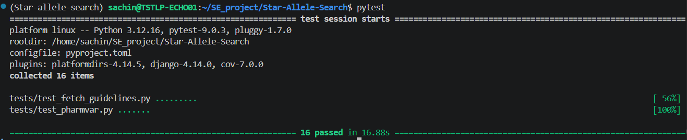
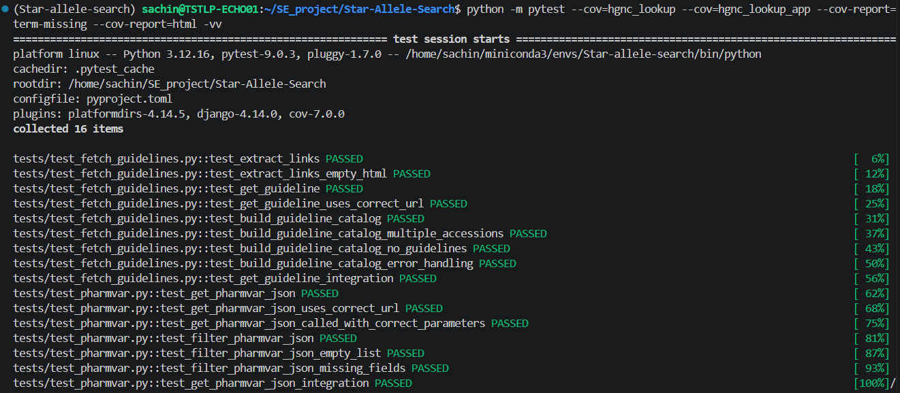
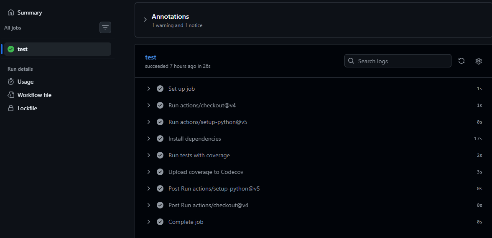

# Testing

## Overview

Star-Allele-Search uses automated testing implemented with PyTest.

## Running Tests

```bash
pytest
```

*Figure 1. Passing pytest result*

## Running Coverage

```bash
pytest --cov=hgnc_lookup --cov=hgnc_lookup_app --cov-report=term-missing --cov-report=html -vv

```

*Figure 2. Verbose pytest result showing all passing*

## Test Categories

### Unit Tests

Unit tests verify individual functions in isolation.

Examples:

- PharmVar data retrieval
- HGNC validation
- Guideline parsing

### Exception Testing

Tests ensure invalid inputs and API failures are handled correctly.

## Continuous Integration

Continuous Integration (CI) is implemented using GitHub Actions.

Every push and pull request automatically triggers the test workflow. The workflow installs dependencies, executes the test suite, generates coverage metrics and uploads coverage reports to Codecov.


*Figure 1. Example of a successful GitHub Actions workflow showing automated testing and coverage reporting..*

????ADD A SCREENSHOT OF GITHUB ACtTIONS AND COVERAGE REPORT HERE/