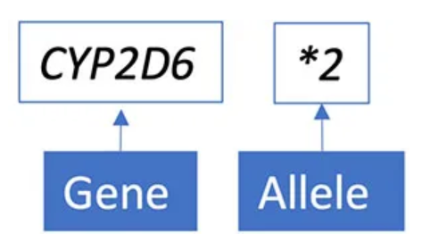
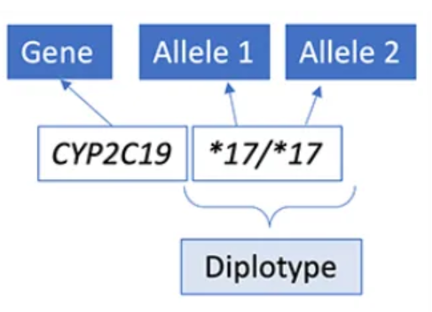
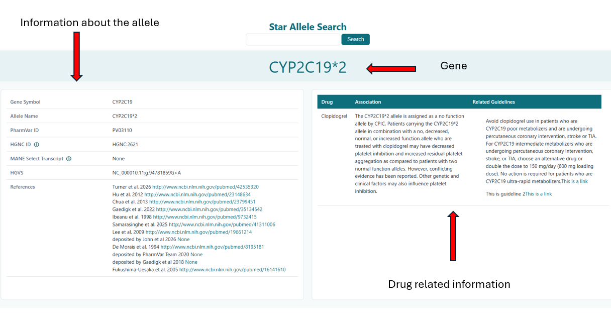

# User Guide

## Overview

Star-Allele-Search is a pharmacogenomics application that retrieves, validates and annotates star allele information from multiple external resources.


<small><em>Figure 1. Homepage</small></em>

The application combines information from:

- PharmVar
- ClinPGx
- CPIC
- DPWG

to provide clinically relevant pharmacogenomic information.


## Understanding Star Alleles and Diplotypes

Pharmacogenomic results are often reported using star allele nomenclature.

A diplotype consists of two star alleles inherited from the two parental chromosomes.

For example:

- Gene: CYP2C19
- Allele 1: *17
- Allele 2: *17
- Diplotype: CYP2C19 *17/*17



<small><em>Figure 2. Example star allele.</small></em>

The figure below illustrates how a diplotype is represented.



<small><em>Figure 3. Example pharmacogenomic diplotype notation.</small></em>

---

# Typical Workflow

The user provides a star allele query in the search box and presses the search button.

```text
CYP2C19*2
```

The application:

1. Retrieves allele information from PharmVar.
2. Validates gene and allele information.
3. Retrieves phenotype information.
4. Retrieves associated pharmacogenomic guidelines.
5. Generates an annotated result.

```text
User Input
     │
     ▼
 Star Allele Query
     │
     ▼
 PharmVar Retrieval
     │
     ▼
 Phenotype Mapping
     │
     ▼
 Guideline Retrieval
     │
     ▼
 Results
```
## Example Search

The following example shows a search for CYP2C19*2.


<small><em>Figure 4. Example search for CYP2C19*2.</em></small>
---

# Searching for a Star Allele

## Example Query

```text
CYP2C19*2
```

The query should contain:

- A valid gene 
- A valid star allele designation

Example valid inputs:

```text
CYP2C19*2
CYP2D6*4
SLCO1B1*5
TPMT*3A
```

---

# Understanding the Results

The application may return several categories of information.

## Star Allele Information

Example:

```text
Gene symbol: CYP2C19
Allele Name: *2
PharmVar ID: PV03110
```

This information is retrieved from PharmVar.

---

## Clinical Guidelines

The application retrieves available recommendations from sources such as:

- CPIC
- DPWG

Example:

```text
Drug: Clopidogrel

Recommendation:
Consider an alternative antiplatelet agent in patients with reduced CYP2C19 function.
```

---

# Common Use Cases

## Clinical Interpretation

The application can be used to identify clinical recommendations associated with pharmacogenomic variants.

Examples:

- Clopidogrel and CYP2C19
- Simvastatin and SLCO1B1
- Thiopurines and TPMT

---

## Research and Validation

Researchers can use the software to:

- Validate allele nomenclature
- Retrieve allele definitions
- Compare annotations across resources
- Review published recommendations

---

# Troubleshooting

## Allele Not Found

Example:

```text
No results returned
```

Possible causes:

- Incorrect gene symbol
- Incorrect star allele designation
- Allele not present in the data source

Verify the allele using PharmVar.

---

## API Connection Errors

Example:

```text
Failed to retrieve PharmVar data
```

Possible causes:

- Network connectivity problems
- Invalid API credentials
- Temporary service outage

Check internet connectivity and API configuration.

---

# Example End-to-End Search

Input:

```text
CYP2C19*2
```

Workflow:

```text
CYP2C19*2
     │
     ▼
 PharmVar Lookup
     ▼
 Function Assignment
     ▼
 Phenotype Retrieval
     ▼
 Guideline Retrieval
     ▼
 Annotated Results
```

Output:

```text
Gene: CYP2C19
Allele: *2
Phenotype: Poor Metaboliser

Guidelines:
- CPIC recommendation
- DPWG recommendation
```

This demonstrates a complete Star-Allele-Search workflow from user query to clinical interpretation.